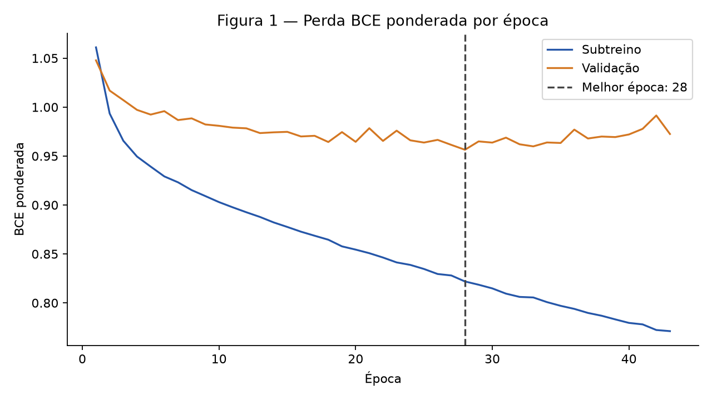
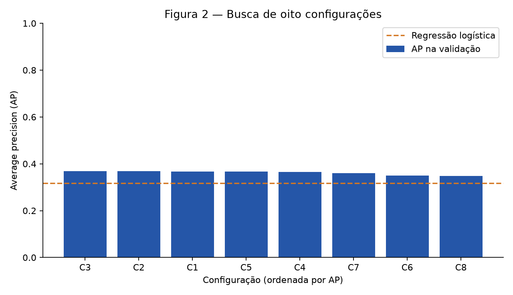
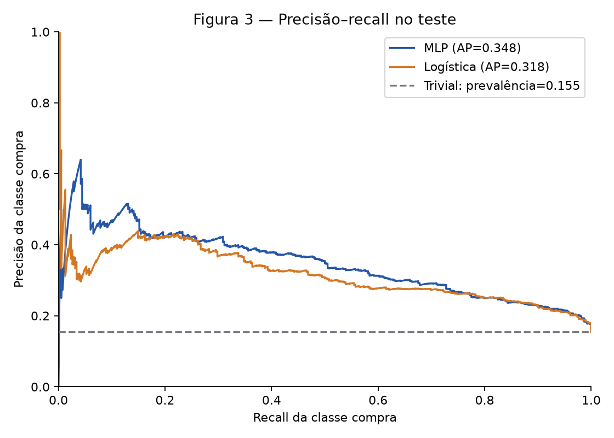
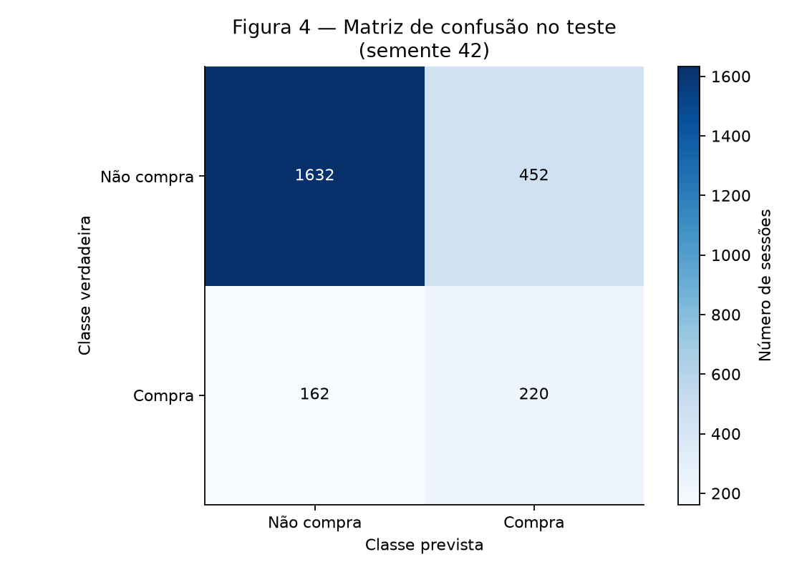
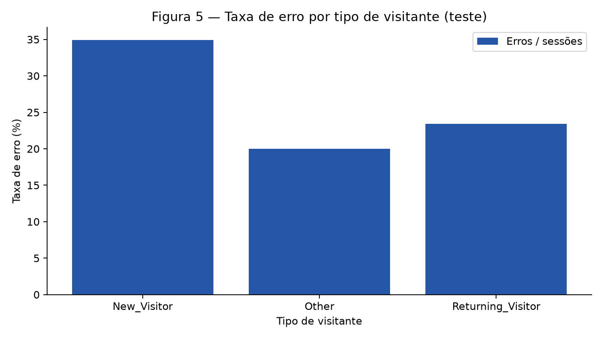
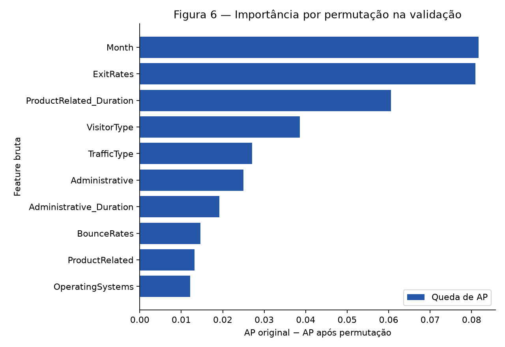

# 2. Classificação — a MLP acrescentou algo à regressão logística?

A MLP melhorou a ordenação das sessões propensas a comprar, mas o resultado ainda não sustenta uma decisão automática de marketing. Sua *average precision* (AP) média no teste foi **0,3525 ± 0,0052**, contra **0,3178** da regressão logística: ganho absoluto de **0,0347**, acima do critério de **0,02** registrado antes dos treinos. Mesmo assim, com o limiar escolhido na validação, só **32,74%** das sessões sinalizadas como compra de fato compraram na execução de semente 42. Os números abaixo são descritivos deste conjunto, não uma garantia para tráfego futuro.

Este projeto foi feito por **Sérgio Carmelo Tôrres Filho** com apoio de IA na organização do relatório e no código. A responsabilidade pelo conteúdo, pelas decisões e pela explicação dos resultados é do autor.

## Etapa 0 — Ponto de partida

Continuamos a [análise exploratória](../eda/index.md) com o mesmo arquivo público [Online Shoppers Purchasing Intention — UCI](https://archive.ics.uci.edu/dataset/468/online%2Bshoppers%2Bpurchasing%2Bintention%2Bdataset), a mesma tarefa binária (`Revenue=True` significa compra) e a mesma primeira dobra de `StratifiedGroupKFold(n_splits=5, shuffle=True, random_state=42)`. O agrupamento usa a assinatura das 17 features brutas para impedir que sessões idênticas apareçam em lados diferentes da divisão. São **9.864 linhas de treino externo** e **2.466 de teste**; a divisão interna do treino gerou **7.891 de subtreino** e **1.973 de validação**. A validação contém **305 compras (15,46%)**. O teste permaneceu fora da busca de configurações.

Importamos `build_preprocessor()` do [arquivo original do EDA](../eda/code/preprocessing.py). Ele faz imputação mediana, limite superior P99 e `log1p` nas numéricas assimétricas, padronização, imputação da moda e one-hot com `handle_unknown="ignore"` nas categóricas. É ajustado **somente no subtreino** durante a busca e **somente no treino externo** no retreino final. Excluímos `PageValues` conforme o EDA: não há comprovação de sua disponibilidade antes do resultado da sessão, e usá-la poderia criar vazamento temporal. O pipeline produz **72 colunas na busca** e **73 no retreino**; `TrafficType=17`, categoria raríssima, não ocorre no subtreino e passa a ocorrer no treino externo. Não há NaN após a transformação; verificamos também **zero assinaturas repetidas das 16 features modeladas** entre treino externo e teste.

Antes de treinar, registramos no [protocolo pré-treino](PROTOCOL.md) a **AP** (`average_precision_score`) como métrica principal. Ela avalia a ordenação da classe positiva ao longo de todos os limiares; a acurácia é pouco informativa quando apenas cerca de 15% das sessões compram. Sucesso significa **AP média da MLP em três sementes no teste ≥ AP do melhor baseline + 0,02**, diferença absoluta. A escolha da configuração, da época e do limiar foi feita na validação. O histórico do Git registra o protocolo em um commit anterior à busca, e a busca em outro anterior à avaliação final.

## Etapa 1 — Baselines

Os dois baselines receberam exatamente a matriz produzida pelo pipeline ajustado no mesmo subtreino: `DummyClassifier(strategy="most_frequent")` e `LogisticRegression(class_weight="balanced", max_iter=2000)`. O primeiro não identifica nenhuma compra; a acurácia aparente de **84,54%** na validação equivale simplesmente à fração de não compradores. A regressão logística alcançou **AP 0,3168**, mais que o dobro da prevalência/AP trivial de **0,1546**, mas ainda deixa informação não linear para a MLP tentar captar.

| Modelo | AP na validação | ROC-AUC | Acurácia no limiar definido | F1 da classe compra |
|---|---:|---:|---:|---:|
| Classe majoritária | 0,1546 | 0,5000 | 0,8454 | 0,0000 |
| Regressão logística | 0,3168 | 0,7476 | 0,7572 | 0,4123 |

Para a logística, o limiar **0,6135** foi escolhido na validação pelo maior F1 da classe compra; para o trivial, **0,5**. Os mesmos limiares foram mantidos no teste. A ponderação de classes combate o desbalanceamento, mas não altera a geometria linear do baseline.

## Etapa 2 — A rede

A MLP foi implementada neste projeto em PyTorch, **sem usar `MLPClassifier`**. A configuração selecionada tem **72 entradas transformadas → 64 neurônios ReLU → 1 logit** durante a busca. A camada oculta permite interações e fronteiras não lineares entre indicadores de comportamento e categorias. Escolhemos comparar 32, 64 e 128 unidades: 64 oferece capacidade intermediária diante de 7.891 sessões de subtreino, sem presumir que mais neurônios seriam melhores. Usamos inicialização de Kaiming nos pesos e biases nulos; isso evita começar com ativações ocultas todas simétricas ou escalas inadequadas para ReLU. O logit vai diretamente para `BCEWithLogitsLoss`, que combina a sigmoide e a entropia cruzada de forma numericamente estável. No subtreino, `pos_weight = 6670/1221 = 5,4627`; esse fator é **recalculado somente no treino**, nunca a partir da validação ou do teste.

O número de parâmetros na busca é `(72×64 + 64) + (64×1 + 1) = 4.737`, contra **7.891** linhas de subtreino (0,60 parâmetro por linha). No retreino, a categoria adicional produz `(73×64 + 64) + 65 = 4.801` parâmetros, contra **9.864** linhas (0,49 por linha). Essa comparação mostra que há capacidade suficiente para sobreajuste; a parada antecipada e a regularização importam.

O [script executável](code/experiment.py) contém a rede, o loop, os baselines, os cálculos e as seis figuras. Para reproduzir a partir de um clone limpo, instale `requirements.txt` e execute, nesta ordem:

```powershell
python docs/projects/classification/code/experiment.py search
python docs/projects/classification/code/experiment.py final
```

Se `final.json` já existir (como em um clone do repositório), o segundo comando **verifica a AP reproduzida contra a evidência publicada e não a sobrescreve**; divergências acima de 0,0001 provocam erro. Esta repetição é apenas uma verificação de reprodutibilidade, nunca uma nova escolha de modelo. A saída numérica auditável está em [search.json](outputs/search.json) e [final.json](outputs/final.json). O código integral é incluído abaixo a partir do arquivo realmente executado:

??? note "Código integral do experimento"

    ```python
    --8<-- "docs/projects/classification/code/experiment.py"
    ```

## Etapa 3 — Treinamento

Treinamos em lotes de **128** com **AdamW**, taxa **0,001** na configuração vencedora, até **120 épocas** no máximo. Lotes menores que o conjunto inteiro dão atualizações frequentes sem o custo de uma amostra por passo. O AdamW desacopla o decaimento dos pesos do gradiente da perda. A taxa 0,001 é um ponto de partida moderado para entradas padronizadas; também testamos 0,0005 na busca. O teto de 120 épocas permite convergência sem forçar todas elas: a validação decide quando parar. A perda ponderada usa apenas as frequências do subtreino. A cada época calculamos a perda no treino e na validação; quando a validação não melhora por **15 épocas**, encerramos e **restauramos os pesos** da melhor época.



**Figura 1.** A perda de subtreino caiu de **1,0610** para **0,7712** ao longo de **43 épocas**. A validação melhorou de **1,0478** até **0,9565 na época 28**, mas terminou em **0,9726** enquanto o treino continuava melhorando: sinal de sobreajuste após aproximadamente a época 28. A AP do checkpoint restaurado foi **0,3691** na validação; não usamos o último iterando. No retreino sobre as **9.864** linhas de treino externo, treinamos do zero por **28 épocas**, número congelado pela validação, sem olhar o teste para parar.

## Etapa 4 — Regularização e hiperparâmetros

A busca fixada no código comparou **8 configurações**, alterando largura/profundidade, taxa de aprendizado, `weight_decay` e `dropout`. Há modelos sem regularização (C1/C2), só decaimento (C3), só dropout (C4), combinação (C5–C8). A ordenação abaixo é pela **AP na validação**, e não pelo teste. `weight_decay` desencoraja pesos grandes; dropout remove aleatoriamente ativações ocultas durante o treino. Não afirmamos que ambos ajudam necessariamente neste dataset.

| Ordem | ID | Camadas ocultas | Taxa | Weight decay | Dropout | Parâmetros | Melhor época | AP validação |
|---:|---|---|---:|---:|---:|---:|---:|---:|
| 1 | C3 | 64 | 0,0010 | 0,001 | 0 | 4.737 | 28 | 0,3691 |
| 2 | C2 | 64 | 0,0010 | 0 | 0 | 4.737 | 28 | 0,3686 |
| 3 | C1 | 32 | 0,0010 | 0 | 0 | 2.369 | 28 | 0,3670 |
| 4 | C5 | 64 | 0,0010 | 0,001 | 0,1 | 4.737 | 28 | 0,3662 |
| 5 | C4 | 64 | 0,0010 | 0 | 0,1 | 4.737 | 28 | 0,3659 |
| 6 | C7 | 128 | 0,0005 | 0,01 | 0,2 | 9.473 | 43 | 0,3598 |
| 7 | C6 | 64, 32 | 0,0010 | 0,001 | 0,1 | 6.785 | 18 | 0,3502 |
| 8 | C8 | 32, 16 | 0,0005 | 0,001 | 0,2 | 2.881 | 48 | 0,3477 |



**Figura 2.** C3 superou C2, idêntica exceto pelo `weight_decay`, por apenas **0,0006 AP**: diferença pequena, sem evidência de benefício robusto da técnica isolada. C4 (só dropout) e C5 (as duas técnicas) ficaram abaixo de C2. As redes mais profundas C6/C8 também não melhoraram a validação; maior capacidade ou mais regularização não garantem ganho. C3 foi escolhida pela regra prévia de maior AP (desempate: menor perda, depois menos parâmetros).

## Etapa 5 — Avaliação no teste

Somente depois de congelar **C3**, **28 épocas** e o limiar **0,5808** (máximo F1 comprador na validação) reajustamos o pipeline no treino externo e avaliamos o teste. Maximizar F1 dá peso igual à precisão e ao recall da compra porque **não há custos monetários observados** de falso positivo versus falso negativo. É uma regra operacional provisória, não o limiar ótimo de negócio. Cada uma das sementes **42, 43 e 44** treinou uma rede nova; cada rede foi avaliada uma vez no mesmo teste. Os baselines também foram reajustados no treino externo. AP e ROC-AUC independem do limiar; as demais métricas abaixo usam os limiares da validação.

| Modelo (teste) | AP | ROC-AUC | Acurácia | F1 macro | Precisão compra | Recall compra | F1 compra |
|---|---:|---:|---:|---:|---:|---:|---:|
| Trivial | 0,1549 | 0,5000 | 0,8451 | 0,4580 | 0,0000 | 0,0000 | 0,0000 |
| Logística | 0,3178 | 0,7477 | 0,7429 | 0,6082 | 0,3025 | 0,5052 | 0,3784 |
| MLP, semente 42 | 0,3482 | 0,7633 | 0,7510 | 0,6296 | 0,3274 | 0,5759 | 0,4175 |
| MLP, semente 43 | 0,3583 | 0,7713 | 0,7263 | 0,6220 | 0,3143 | 0,6492 | 0,4236 |
| MLP, semente 44 | 0,3511 | 0,7650 | 0,7105 | 0,6055 | 0,2956 | 0,6283 | 0,4020 |

A **AP média da MLP é 0,3525 ± 0,0052** (desvio-padrão amostral, três sementes); o ganho sobre a melhor baseline, logística com AP **0,3178**, é **0,0347**, maior que o limiar pré-registrado de **0,02** e cerca de **6,6 vezes** o desvio observado entre sementes. Portanto, o critério foi atingido **neste split**, sem alegar significância estatística ou generalização temporal: as três execuções compartilham as mesmas linhas de teste.



**Figura 3.** A MLP (semente 42) fica acima da logística em boa parte da faixa de recall, embora ambas percam precisão quando se tenta captar mais compradores. A linha horizontal do trivial representa a prevalência de compras, **15,49%**, e não uma fronteira operacional variável.



**Figura 4.** Na semente 42, entre **2.084 não compradores**, houve **1.632 negativos corretos** e **452 falsos positivos**; entre **382 compradores**, **220 positivos corretos** e **162 falsos negativos**. Assim, para a classe 0 a precisão/recall/F1 foram **0,9097 / 0,7831 / 0,8417**; para a classe 1, **0,3274 / 0,5759 / 0,4175**. O F1 macro de **0,6296** mostra melhor equilíbrio que a acurácia isolada. O classificador trivial tem acurácia maior porque sempre responde “não compra”, mas seu recall de compra é **zero**.

## Etapa 6 — Análise de erros

Usamos as predições finais da semente 42 para descrever erros por `VisitorType`, categoria já examinada no EDA. Esta análise é **posterior** à seleção e não altera a rede nem o limiar.

| Tipo de visitante | Sessões teste | Compras | Erros | Taxa de erro | FNR entre compradores | FPR entre não compradores |
|---|---:|---:|---:|---:|---:|---:|
| `New_Visitor` | 318 | 77 | 111 | **34,91%** | 22,08% | 39,00% |
| `Other` | 10 | 1 | 2 | 20,00% | 100,00% | 11,11% |
| `Returning_Visitor` | 2.138 | 304 | 501 | 23,43% | 47,37% | 19,47% |



**Figura 5.** A maior taxa geral de erro está em **`New_Visitor`: 111/318 = 34,91%**, principalmente falsos positivos (FPR **39,00%**). Uma hipótese é que sinais de navegação de novos visitantes pareçam intenção de compra sem se converter. Em `Returning_Visitor`, o FNR é **47,37%**; a rede perde compradores de retorno cujo comportamento se parece ao da maioria que não compra. `Other` tem apenas **10 casos e uma compra**: seu FNR de 100% não permite conclusão estável.

Entre os erros mais confiantes, três falsos positivos foram as linhas **6015** (probabilidade prevista **0,9622**), **5959** (**0,9609**) e **8378** (**0,9468**), todas sem compra. As linhas 6015 e 8378 têm `ExitRates` baixos (**0,0094** e **0,0048**) e longas durações em produtos (**3.025,3** e **1.390,1**), sinais de engajamento que podem levar a um falso alarme; a 5959 também tem `ExitRates` baixo (**0,0150**). Três falsos negativos foram **10531** (**0,0289**), **3581** (**0,0334**) e **9429** (**0,0336**), todas compras. As linhas 10531 e 9429 têm `ExitRates` relativamente altos (**0,1083** e **0,0917**), compatíveis com uma sessão aparentemente desistente que ainda comprou. A 3581, com `ExitRates` **0,0128**, mostra que essa hipótese não explica todos os erros. Esses casos são **hipóteses**, não causas demonstradas.

Permutamos cada feature bruta separadamente **na validação**, sem reajustar o pipeline ou selecionar nova rede, e medimos a queda da AP. Os maiores impactos foram `Month` (**0,0817**), `ExitRates` (**0,0809**) e `ProductRelated_Duration` (**0,0605**); `VisitorType` veio em seguida (**0,0386**). A referência de AP nessa validação foi **0,3691**. Isso é coerente com o EDA: a taxa de compra variava muito por mês (por exemplo, **9,72% em março** contra **25,50% em novembro** no treino externo), e navegação/saída apareciam entre os eixos de variação. Já o par `Informational`–`Informational_Duration` era muito correlacionado no EDA (**ρ de Spearman 0,9504**), mas não aparece no topo da importância individual; features redundantes podem dividir informação, portanto uma permutação isolada pode subestimar sua relevância conjunta.



**Figura 6.** A permutação de `Month` reduziu a AP de **0,3691** para aproximadamente **0,2874**, maior queda entre as features. Esta é uma medição de dependência preditiva **neste modelo e nesta validação**, não uma explicação causal do comportamento de compra. As categorias raras e a correlação entre atributos limitam a estabilidade da ordenação de importância.

## Etapa 7 — Conclusão

A MLP **valeu a pena como experimento de modelagem**: o ganho médio de **0,0347 AP** sobre a logística ultrapassou o critério de **0,02** e foi maior que a oscilação entre três inicializações. A melhora, porém, é modesta diante da AP final de **0,3525** e da precisão de compra de apenas **0,3274** na semente 42. Antes de qualquer uso prático, seria preciso verificar quando cada feature fica disponível, obter dados temporalmente mais recentes, fazer validação temporal e calibrar o limiar com custos reais de contato indevido (falsos positivos) e de oportunidades perdidas (falsos negativos). O grupo de novos visitantes, com **34,91%** de erro, merece atenção especial; isso não prova discriminação, mas indica risco desigual de decisão.

O teste fixo veio de uma divisão aleatória agrupada por assinaturas, não de um período futuro; portanto não mede deriva temporal. A busca de oito configurações e uma única validação pode favorecer a vencedora por acaso. A comparação entre sementes mede apenas variação de inicialização, não incerteza de amostragem. Com mais tempo, testaríamos validação temporal e múltiplas divisões externas, calibração probabilística e uma baseline de árvores/boosting — **sem usar o teste atual para escolher** essas mudanças. O código e as decisões podem ser auditados a partir do [protocolo](PROTOCOL.md), dos [resultados de validação](outputs/search.json) e dos [resultados finais](outputs/final.json).

## Resumo dos resultados

| # | Resumo | Valor |
|---:|---|---|
| 1 | Dataset, tarefa, alvo e métrica principal | Online Shoppers (UCI); classificação binária; `Revenue`; AP da classe compra |
| 2 | Treino · validação · teste (linhas) | 7.891 subtreino · 1.973 validação · 2.466 teste; treino externo total 9.864 |
| 3 | Melhor baseline e sua métrica no teste | Regressão logística; AP **0,3178** |
| 4 | Rede escolhida: camadas × unidades, nº de parâmetros, regularização | 73 → 64 ReLU → 1 logit; **4.801** parâmetros no retreino; `weight_decay=0,001`, sem dropout |
| 5 | Otimizador, taxa, batch e época em que parou | AdamW; **0,001**; **128**; melhor época **28**, parada antecipada na **43**; retreino final por **28** |
| 6 | Métrica principal da rede no teste (média ± desvio, 3 sementes) | AP **0,3525 ± 0,0052**; sementes 42, 43, 44 |
| 7 | Critério de sucesso atingido? | **Sim**: ganho **0,0347 AP** ≥ **0,02** pré-registrado |
| 8 | Subgrupo com o maior erro e o valor | `New_Visitor`: **111/318 = 34,91%** de erro no teste (semente 42) |
