# Projeto 1 — Análise exploratória de dados

**Equipe:** Sérgio Carmelo Tôrres Filho · **Tarefa:** classificação binária de `Revenue` · **Semente:** 42. Este relatório prepara os dados para uma futura rede neural; **nenhum modelo foi treinado nesta entrega**. O [CSV original](data/online_shoppers_intention.csv), o [código executado](code/eda_analysis.py) e as [saídas calculadas](outputs/metrics.json) estão no repositório.

## 0. Proposta

**Aprovação do professor:** o integrante informou em **04/11/2026** que a base foi aprovada. O [enunciado](https://insper.github.io/ann-dl/pt/2026.2/projects/eda/) exige aprovação como pré-requisito de correção. O comprovante não foi anexado ao repositório; esta informação registra a confirmação recebida do aluno.

O dataset escolhido é o [Online Shoppers Purchasing Intention Dataset](https://archive.ics.uci.edu/dataset/468/online+shoppers+purchasing+intention+dataset), da UCI: **12.330 sessões × 18 colunas**, sendo **17 features (10 numéricas, 7 categóricas)** e o alvo booleano `Revenue`, presente no arquivo. Cada linha representa uma sessão de um usuário distinto durante um ano, segundo a fonte. A tarefa é prever se a sessão termina em compra. A base é pública, tabular, mista, excede 1.000 instâncias/5 features e não é uma das bases clássicas proibidas. A motivação é estudar a interação entre comportamento de navegação, sazonalidade e compra num cenário real. O risco inicial é o desbalanceamento da compra (**15,47%**), junto à possível indisponibilidade temporal de `PageValues`. A mesma base seguirá para a etapa de classificação.

## 1. Inspeção inicial

### A — Dicionário de dados

A [UCI](https://archive.ics.uci.edu/dataset/468/online+shoppers+purchasing+intention+dataset) descreve métricas agregadas da sessão e do site. Não declara a unidade das durações; por isso não a presumo. Os códigos de sistema, navegador, região e tráfego são categorias, não números ordenados. O CSV commitado tem SHA-256 `b3055ee355f59134d851d32641183cb4a8b45def7124d2f50442a042f358e0d9`.

| Coluna | Significado | Tipo | Unidade/escala |
|---|---|---|---|
| `Administrative` | Páginas administrativas visitadas | Numérica discreta | Páginas |
| `Administrative_Duration` | Tempo total nelas | Numérica contínua | Tempo; unidade não informada |
| `Informational` | Páginas informativas visitadas | Numérica discreta | Páginas |
| `Informational_Duration` | Tempo total nelas | Numérica contínua | Tempo; unidade não informada |
| `ProductRelated` | Páginas de produto visitadas | Numérica discreta | Páginas |
| `ProductRelated_Duration` | Tempo total nelas | Numérica contínua | Tempo; unidade não informada |
| `BounceRates` | Taxa média de rejeição das páginas | Numérica contínua | Proporção, 0–1 |
| `ExitRates` | Taxa média de saída das páginas | Numérica contínua | Proporção, 0–1 |
| `PageValues` | Valor médio de páginas segundo analytics | Numérica contínua | Valor; unidade monetária não informada |
| `SpecialDay` | Proximidade de data especial | Numérica contínua | Escore, 0–1 |
| `Month` | Mês da sessão | Categórica nominal | Categoria textual |
| `OperatingSystems` | Código do sistema operacional | Categórica nominal | Código |
| `Browser` | Código do navegador | Categórica nominal | Código |
| `Region` | Código da região | Categórica nominal | Código |
| `TrafficType` | Código da origem de tráfego | Categórica nominal | Código |
| `VisitorType` | Tipo de visitante | Categórica nominal | Categoria textual |
| `Weekend` | Sessão em fim de semana | Categórica binária | Booleano |
| `Revenue` | Sessão terminou em compra | **Alvo binário** | `False`/`True` |

### B — Qualidade

**Faltantes:** **0 de 12.330 (0,00%) em cada uma das 18 colunas**. A [contagem por coluna](outputs/missing_values.csv) está versionada; a tabela explicita cada verificação.

| Coluna | n | % | Coluna | n | % |
|---|---:|---:|---|---:|---:|
| `Administrative` | 0 | 0,00 | `Administrative_Duration` | 0 | 0,00 |
| `Informational` | 0 | 0,00 | `Informational_Duration` | 0 | 0,00 |
| `ProductRelated` | 0 | 0,00 | `ProductRelated_Duration` | 0 | 0,00 |
| `BounceRates` | 0 | 0,00 | `ExitRates` | 0 | 0,00 |
| `PageValues` | 0 | 0,00 | `SpecialDay` | 0 | 0,00 |
| `Month` | 0 | 0,00 | `OperatingSystems` | 0 | 0,00 |
| `Browser` | 0 | 0,00 | `Region` | 0 | 0,00 |
| `TrafficType` | 0 | 0,00 | `VisitorType` | 0 | 0,00 |
| `Weekend` | 0 | 0,00 | `Revenue` | 0 | 0,00 |

Há **125 linhas idênticas (1,01%)**, inclusive no alvo; também são 125 se `Revenue` for ignorado. A UCI informa que as sessões pertencem a usuários distintos; igualdade dos agregados não prova repetição do registro. Por isso **mantive as sessões** e agrupei assinaturas idênticas na separação (1D), confirmando **0 assinaturas compartilhadas** entre treino e teste.

Verificações de impossibilidade: **0** contagens/durações negativas, **0** `PageValues` negativos, **0** taxas fora de 0–1, **0** códigos categóricos não positivos, **0** meses desconhecidos e **0** células textuais vazias. Não há identificador nem coluna constante. A única coluna descartada é **`PageValues`**: a UCI relaciona a métrica ao valor de páginas antes de uma transação, mas não documenta sua disponibilidade no **instante de previsão**. No treino, a média é **27,13** para compra contra **2,02** para não compra (medianas **16,34** e **0,00**). Essa associação não prova vazamento; a exclusão é conservadora até haver confirmação temporal operacional.

### C — Alvo

No dataset completo, `Revenue=False` tem **10.422 sessões (84,53%)** e `Revenue=True`, **1.908 (15,47%)**. A razão é **5,46:1**. A futura modelagem deverá avaliar a classe positiva e comparar com a linha de base majoritária, não só reportar acurácia.

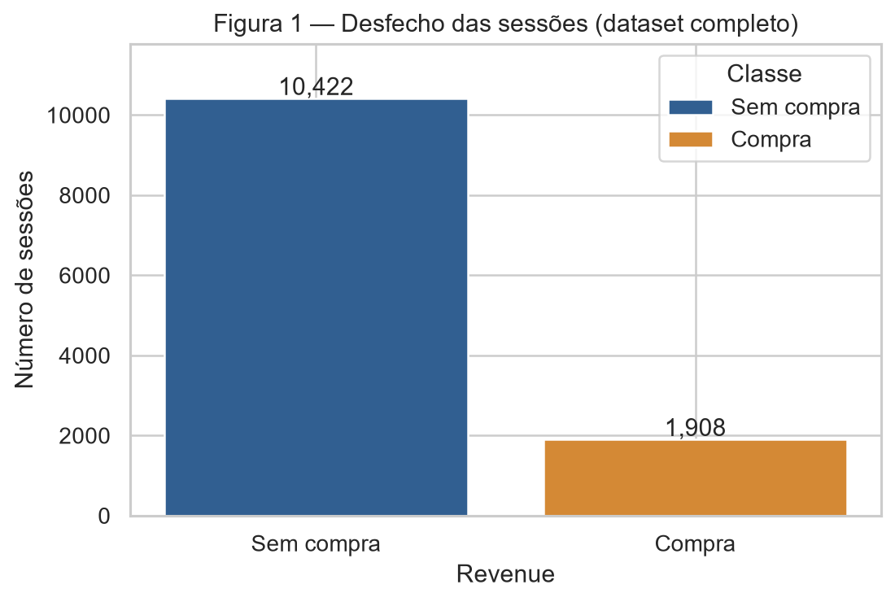

**Conclusão da Figura 1:** prever sempre “sem compra” alcançaria 84,53% sem aprender intenção de compra; o desbalanceamento é substantivo.

### D — Treino e teste

Antes de ajustar imputação, limites, escalas, encoding ou PCA, usei a primeira divisão de `StratifiedGroupKFold(n_splits=5, shuffle=True, random_state=42)`, estratificada por `Revenue` e agrupada pelo hash das 17 features. A divisão **80%/20%** preserva aproximadamente a proporção de compra e impede que linhas com features iguais apareçam dos dois lados. São **9.864 sessões no treino (1.526 compras; 15,47%)** e **2.466 no teste (382 compras; 15,49%)**. Não há data individual para corte temporal; `Month` não ordena as sessões dentro do ano. O teste é reservado à avaliação futura. A análise adiante e todo `fit` usam somente treino; isto não mede generalização para outro período ou loja.

## 2. Análise univariada

### A — Numéricas

A Tabela 1 é calculada nas **9.864 linhas de treino**, antes de transformação. O [CSV completo](outputs/numeric_summary.csv) inclui mínimo, máximo, zeros, assimetria e P99.

**Tabela 1 — Estatísticas das dez numéricas no treino (aproximações).**

| Feature | Média | Mediana | Desvio | Q1 | Q3 |
|---|---:|---:|---:|---:|---:|
| `Administrative` | 2,299 | 1,000 | 3,311 | 0,000 | 4,000 |
| `Administrative_Duration` | 80,102 | 8,000 | 177,398 | 0,000 | 91,989 |
| `Informational` | 0,508 | 0,000 | 1,284 | 0,000 | 0,000 |
| `Informational_Duration` | 34,340 | 0,000 | 141,242 | 0,000 | 0,000 |
| `ProductRelated` | 31,707 | 18,000 | 45,169 | 7,000 | 37,000 |
| `ProductRelated_Duration` | 1.197,575 | 599,000 | 1.962,745 | 183,500 | 1.474,531 |
| `BounceRates` | 0,0221 | 0,0031 | 0,0485 | 0,0000 | 0,0167 |
| `ExitRates` | 0,0430 | 0,0251 | 0,0486 | 0,0143 | 0,0500 |
| `SpecialDay` | 0,0599 | 0,0000 | 0,1968 | 0,0000 | 0,0000 |
| `PageValues` | 5,905 | 0,000 | 18,539 | 0,000 | 0,000 |

As Figuras 2–3 cobrem **todas** as numéricas em duas figuras. Contagens/durações e `PageValues` aparecem em `log(1+x)` **somente para visualização**; as densidades das classes são normalizadas separadamente, portanto não indicam prevalência.

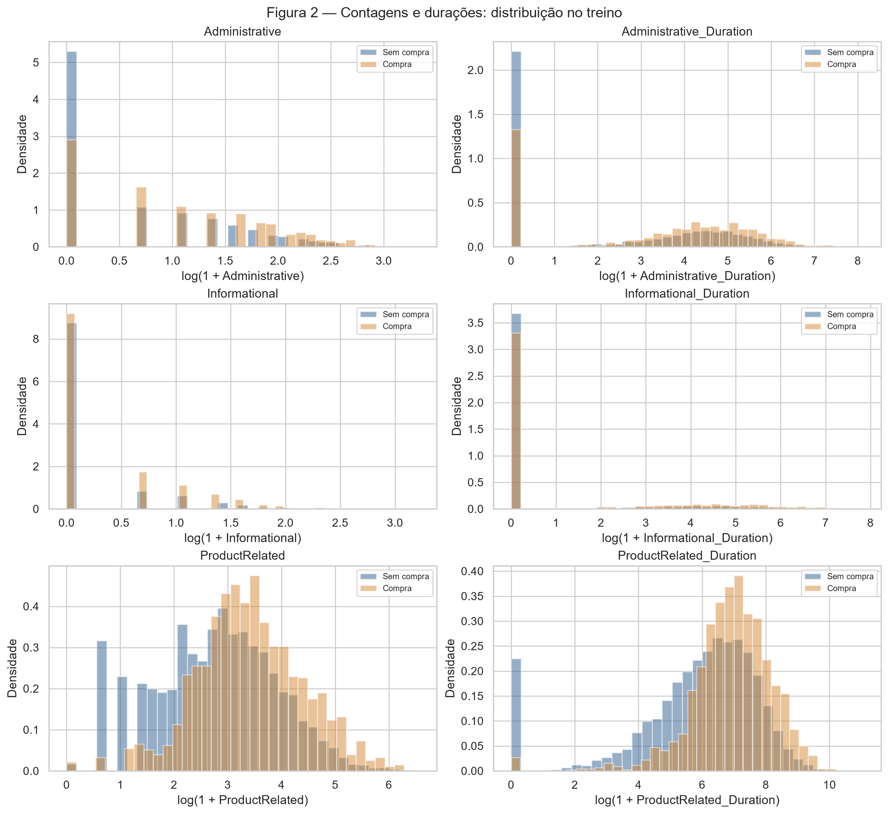

**Conclusão da Figura 2:** as seis variáveis são assimétricas à direita, com muitos zeros. `Informational_Duration` é zero em **80,41%** do treino; `ProductRelated_Duration` vai até **63.973,52**, contra mediana **599,00**. A cauda justifica compressão e limite superior robusto sem eliminar sessões.

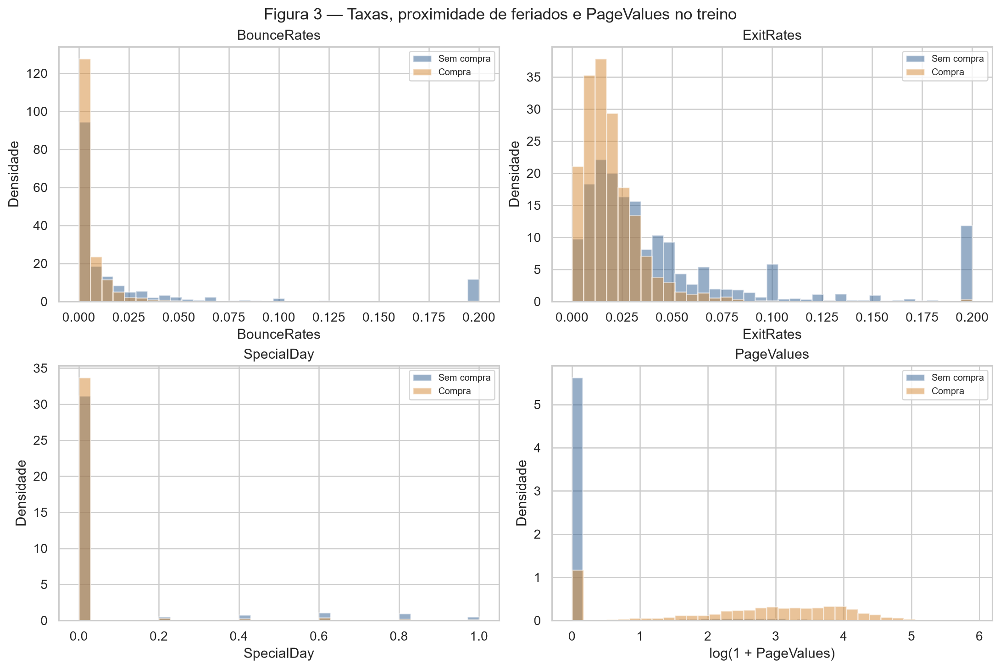

**Conclusão da Figura 3:** `BounceRates`/`ExitRates` se concentram perto de zero; **90,10%** de `SpecialDay` e **77,79%** de `PageValues` são zero. `PageValues` tem cauda até **361,76**, mas sua exclusão do pipeline se deve ao risco temporal de 1B. Picos discretos não são tomados como modos de uma distribuição contínua.

### B — Categóricas

Defini “rara” como categoria com menos de **1% das 9.864 sessões**. A Tabela 2 resume **todas as sete features**; a [frequência de cada uma de suas categorias, com contagem e percentual](outputs/categorical_frequencies.csv) está commitada para consulta.

**Tabela 2 — Cardinalidade e frequências dominantes no treino.**

| Feature | Categorias | Mais frequente (n; %) | Categorias <1% |
|---|---:|---|---:|
| `Month` | 10 | `May` (2.655; 26,92%) | 0 |
| `OperatingSystems` | 8 | `2` (5.269; 53,42%) | 4 |
| `Browser` | 13 | `2` (6.378; 64,66%) | 6 |
| `Region` | 9 | `1` (3.802; 38,54%) | 0 |
| `TrafficType` | 19 | `2` (3.156; 32,00%) | 8 |
| `VisitorType` | 3 | `Returning_Visitor` (8.413; 85,29%) | 1 (`Other`) |
| `Weekend` | 2 | `False` (7.542; 76,46%) | 0 |

??? info "Frequências completas — todas as categorias"

    --8<-- "docs/projects/eda/outputs/categorical_frequencies.txt"

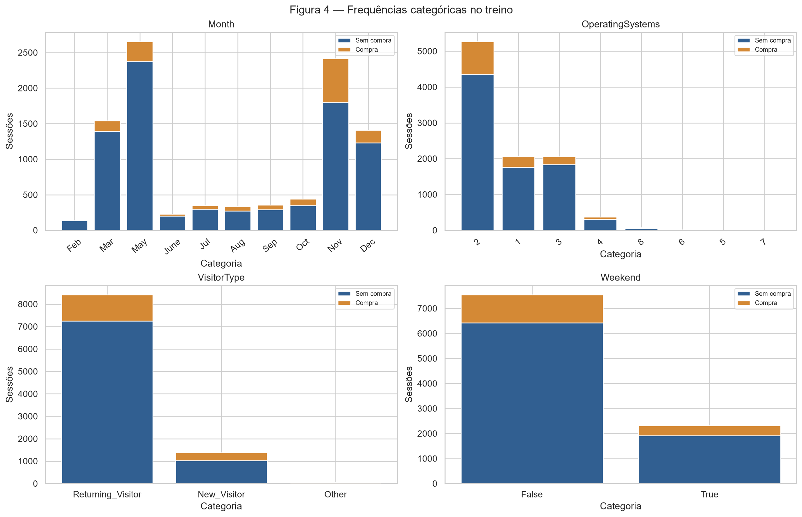

**Conclusão da Figura 4:** `Month` varia em volume e `VisitorType` é dominada por recorrentes. Há registros de **dez meses**, mas **janeiro e abril não aparecem**; não se pode inferir ausência real de visitantes nesses meses nem projetar sazonalidade para o ano inteiro. `TrafficType` tem a maior cardinalidade (**19**) e oito códigos raros; `Browser` tem **13** e seis raros. Para não sobrecarregar a figura, ela mostra quatro features; a Tabela 2 e o CSV cobrem as sete. Códigos categóricos não devem entrar como números contínuos na rede.

## 3. Análise bivariada e multivariada

### A — Numérica × numérica

Usei **Spearman** no treino porque a Tabela 1/Figuras 2–3 mostram caudas, muitos zeros e possível associação monotônica não linear. A [matriz de correlação completa](outputs/spearman_correlations.csv) acompanha o mapa.

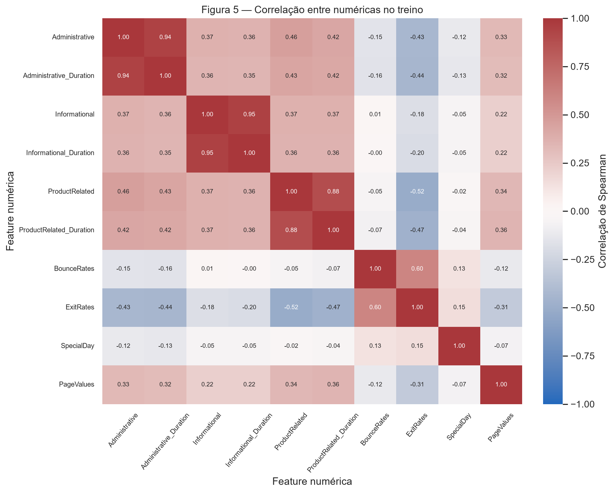

**Conclusão da Figura 5:** `Informational` × `Informational_Duration` é o par mais associado, **ρ=0,9504**: mais páginas informativas quase sempre implicam mais tempo nelas, indicando redundância parcial. `BounceRates` × `ExitRates` tem **ρ=0,6014**, mas não é duplicata. Não removi variáveis apenas por correlação; isso pede ablação no treino/validação futura.

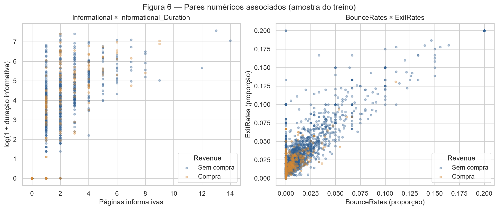

**Conclusão da Figura 6:** o primeiro par tem relação monotônica e muitos empates em zero, compatíveis com ρ alto sem equivalência perfeita. O segundo tem associação positiva com dispersão. As classes se sobrepõem nos dois planos, então essas duplas não separam o alvo sozinhas. Para legibilidade foi usada uma amostra fixa de **3.000 sessões do treino**.

### B — Categórica × alvo

A Figura 7 exibe composição por categoria. A [tabela de taxas de compra das categorias de **todas** as sete features](outputs/category_target_rates.csv) inclui contagens, evitando interpretar um percentual extremo baseado em pouquíssimas sessões como padrão estável.

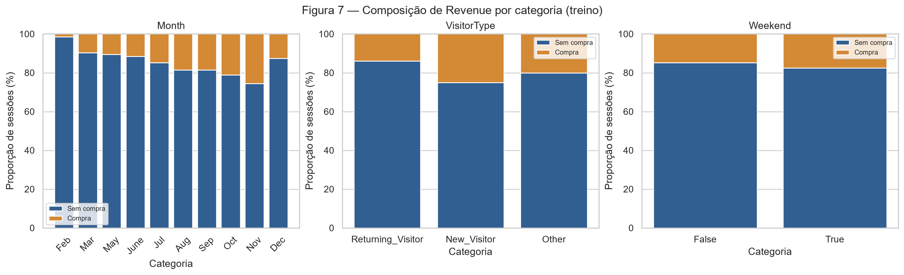

**Conclusão da Figura 7:** em novembro houve compra em **25,50%** das sessões (**2.416** linhas), contra **1,46%** em fevereiro (**137**). `New_Visitor` tem **25,07%** (**1.376**) e `Returning_Visitor`, **13,86%** (**8.413**). Em `Weekend`, as taxas são **17,44%** (**2.322**) e **14,86%** (**7.542**). São associações, não efeitos causais; taxas de códigos raros são incertas.

### C — Numérica × categórica

Comparei tempo de páginas de produto por `VisitorType` e `ExitRates` por `Weekend`, colorindo também pelo alvo. Outliers foram **ocultados apenas nos boxplots**, não removidos dos dados.

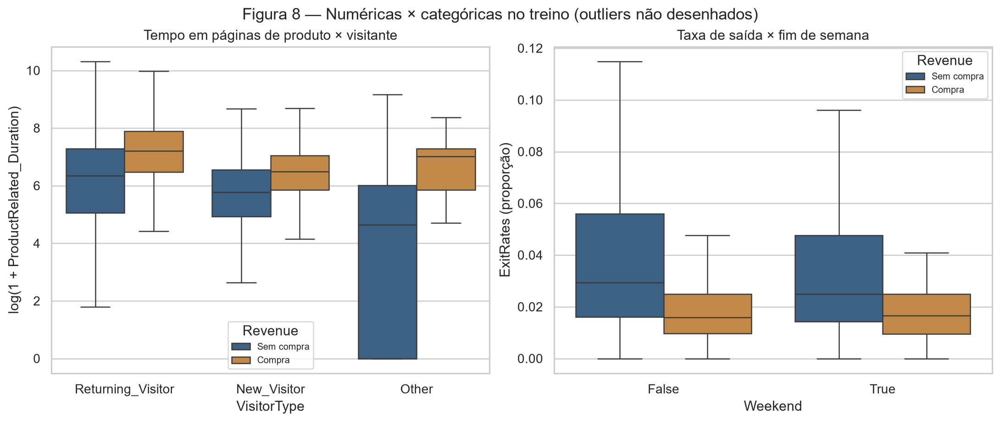

**Conclusão da Figura 8:** entre recorrentes, a mediana de `ProductRelated_Duration` é **1.341,63** nas compras contra **568,48** nas não compras; os IQRs são **651,19–2.678,39** contra **157,00–1.457,01**, indicando diferença de **posição e espalhamento**. Em dias úteis, a mediana de `ExitRates` cai de **0,0294** (sem compra) para **0,0159** (compra), com IQR **0,0161–0,0560** contra **0,0096–0,0250**: também diferem posição e dispersão. `VisitorType=Other` tem só **75** sessões, logo seu boxplot é instável.

## 4. Pré-processamento

### A — Estratégias

| Tema | Achado | Estratégia, sempre ajustada no treino |
|---|---|---|
| Faltantes | 0 agora (1B), mas dados futuros podem faltar | `SimpleImputer(median)` nas numéricas e `most_frequent` nas categóricas. |
| Outliers/caudas | `ProductRelated_Duration`: máximo 63.973,52, mediana 599,00 (Tabela 1) | Nas seis contagens/durações, limitar no P99 do treino e aplicar `log1p`. **391/9.864 linhas (3,96%)** afetadas; nenhuma removida. |
| Categorias | Códigos não ordinais; `TrafficType` com 19 categorias (Tabela 2) | One-hot com `handle_unknown="ignore"`; categoria inédita no teste vira zeros no seu bloco. |
| Escala | Durações em milhares, taxas até 0,2 (Tabela 1) | `StandardScaler` após `log1p` e nas três numéricas limitadas. |

Os limites aprendidos no treino foram `Administrative` **14**, `Administrative_Duration` **825,35**, `Informational` **6**, `Informational_Duration` **724,56**, `ProductRelated` **223,37** e `ProductRelated_Duration` **8.898,10**. **391** conta linhas únicas; algumas excedem mais de um limite. O P99 é uma escolha conservadora, não alegação de erro de coleta. `PageValues` fica de fora por risco temporal (1B), não por ser outlier. O alvo não foi reamostrado; eventual ponderação pertence apenas ao treinamento do futuro classificador.

### B — Redução de dimensionalidade

As três projeções usam as **73 features transformadas do treino**. PCA foi ajustada nas **9.864** linhas; PCA, t-SNE e UMAP mostram a **mesma amostra estratificada de 1.500 linhas do treino** (**1.268 sem compra; 232 compras**). O teste não entrou em nenhum ajuste. As projeções 2D servem para diagnóstico visual, não substituem automaticamente o conjunto completo de features.

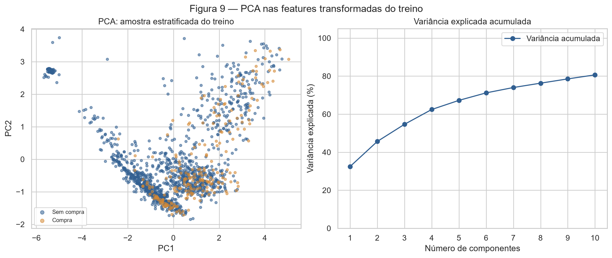

**Conclusão da Figura 9:** PC1 explica **32,48%** e PC2 **13,18%**, juntas **45,66%**. Dez componentes chegam a **80,06%**. Pelos [loadings](outputs/pca_loadings.csv), PC1 pesa `ProductRelated_Duration` **+0,4100**, `ExitRates` **−0,3928** e `ProductRelated` **+0,3908**; PC2 pesa `Informational` **+0,5247**, `Informational_Duration` **+0,5220** e `BounceRates` **+0,4052**. O sinal de um eixo PCA é arbitrário; importa a contribuição relativa. Compras e não compras se sobrepõem amplamente.

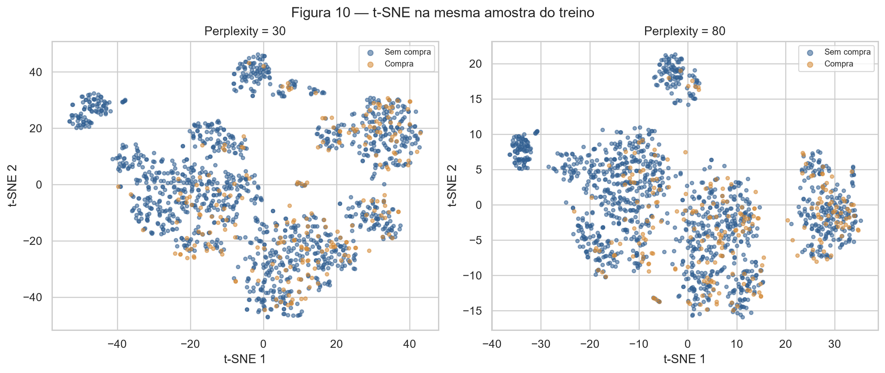

**Conclusão da Figura 10:** `perplexity=30` e **80** expõem agrupamentos locais que a PCA comprime. A disposição muda, mas **não aparece região pura de compras**; as cores seguem misturadas. Não interpreto distâncias ou áreas entre ilhas como distância global ou tamanho real de grupos.

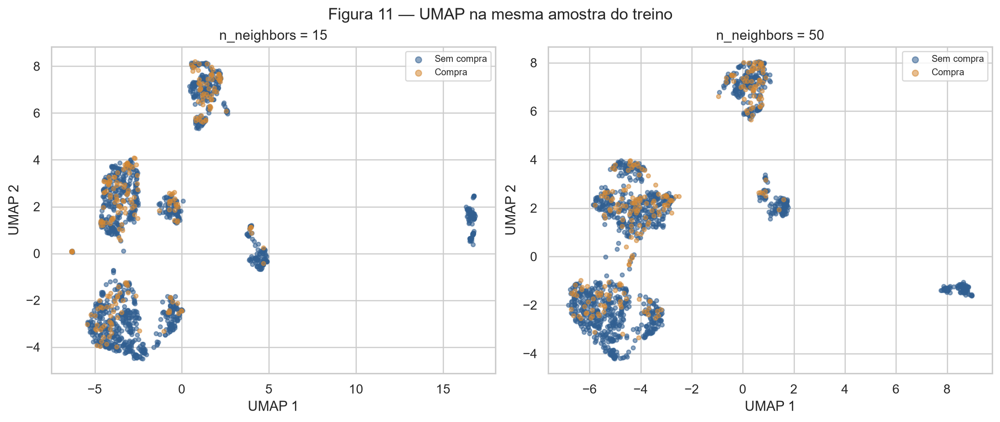

**Conclusão da Figura 11:** `n_neighbors=15` ressalta subgrupos menores, enquanto **50** agrega parte deles. Como t-SNE, mostra estrutura local não aparente na projeção linear, sem separar classes. Ilhas podem refletir categorias e zeros estruturais, não necessariamente perfis de compra; seu tamanho e separação visual não medem prevalência nem distância original.

### C — Pipeline

O arquivo importável [preprocessing.py](code/preprocessing.py) define `build_preprocessor()`: `ColumnTransformer` com `Pipeline` numérico e categórico, sem ajustar nada ao importar. O [script de análise](code/eda_analysis.py) faz `fit_transform` **apenas no treino** e `transform` no teste. Os `shape`s são **(9.864, 73)** e **(2.466, 73)**, com **0 NaN** e **0 infinito** em ambos. São 6 contagens/durações transformadas, 3 numéricas limitadas e 64 indicadores one-hot. `Revenue` e `PageValues` não entram em `X`.

Os [73 nomes produzidos pelo `ColumnTransformer`](outputs/feature_names.csv) estão versionados, em sua ordem, com prefixos `skew__`, `bounded__` e `cat__`; incluem `skew__ProductRelated_Duration`, `bounded__ExitRates`, `cat__Month_Nov`, `cat__TrafficType_20` e `cat__Weekend_True`. O CSV é a lista completa, não uma reconstrução manual. Uma categoria nova mantém o mesmo `shape` graças a `handle_unknown="ignore"`.

??? info "Nomes e ordem das 73 features transformadas"

    --8<-- "docs/projects/eda/outputs/feature_names.txt"

Para reproduzir de um clone limpo: instale `requirements.txt` e execute `python docs/projects/eda/code/eda_analysis.py` na raiz. O script lê o CSV commitado, verifica o split e gera Figuras 1–11 e tabelas em `outputs/`. [test_preprocessing.py](code/test_preprocessing.py) testa o pipeline. Os dois blocos abaixo incorporam o **código-fonte executável** dos arquivos, não uma cópia independente.

??? example "Código completo — pipeline"

    ```python
    --8<-- "docs/projects/eda/code/preprocessing.py"
    ```

??? example "Código completo — análise e figuras"

    ```python
    --8<-- "docs/projects/eda/code/eda_analysis.py"
    ```

## 5. Síntese

Para modelagem futura: **(i)** compra é minoritária (**15,47%**, Figura 1), exigindo métricas da classe positiva; **(ii)** caudas e zeros nas durações (Tabela 1/Figura 2) justificam P99, `log1p` e padronização; **(iii)** mês e tipo de visitante variam nas taxas (Figura 7), mas categorias raras e ausência de validação temporal limitam extrapolação. Dois PCs retêm só **45,66%** (Figura 9); t-SNE/UMAP revelam estrutura local, não classes limpas. `PageValues` foi excluída por risco temporal (1B). **Não há resultado preditivo**, pois nenhum classificador foi treinado.

**Próximo passo e limites:** manter esta base na classificação, definir o instante da predição, ajustar modelos somente no treino/validação e reservar o teste para avaliação final. O relatório registra a aprovação informada pelo integrante, mas não substitui eventual comprovante exigido pela disciplina. Fonte: Sakar & Kastro, *Online Shoppers Purchasing Intention Dataset* (UCI, 2018), DOI [10.24432/C5F88Q](https://doi.org/10.24432/C5F88Q), licença [CC BY 4.0](https://creativecommons.org/licenses/by/4.0/).

### Resumo dos resultados

| # | Resumo dos resultados | Valor |
|---:|---|---|
| 1 | Dataset, tarefa e alvo | Online Shoppers Purchasing Intention; classificação; `Revenue` (`True`/`False`) |
| 2 | Instâncias × features (numéricas / categóricas) | **12.330 × 17** (**10 / 7**); mais 1 alvo |
| 3 | Coluna com mais faltantes e seu percentual | Empate entre todas: **0 (0,00%)** |
| 4 | Colunas descartadas e o motivo | `PageValues`: disponibilidade pré-compra não demonstrada; possível vazamento temporal |
| 5 | Classe minoritária (%) | `Revenue=True`: **1.908 / 12.330 (15,47%)** |
| 6 | Tamanho do treino e do teste | **9.864 / 2.466** (80% / 20%) |
| 7 | Par de numéricas mais correlacionado e valor | `Informational` × `Informational_Duration`: **Spearman ρ=0,9504** |
| 8 | Linhas afetadas pela estratégia de outliers | **391 / 9.864 (3,96%)** no treino; nenhuma removida |
| 9 | Variância explicada por PC1 + PC2 | **45,66%** (32,48% + 13,18%) |
| 10 | `shape` do treino e do teste após o pipeline | **(9.864, 73)** e **(2.466, 73)**; 0 NaN |
